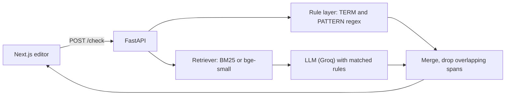

# Style Checker

A writing assistant that checks grammar **and** your own style guide. Upload a style guide, and suggestions follow it, for example rewriting `ebpf` to `eBPF`, removing "simply", or turning passive voice into active voice. Each suggestion shows which rule triggered it.

Stack: FastAPI, Groq (`openai/gpt-oss-20b`), Next.js, TypeScript.

## How it works



1. **Rule layer (exact).** Terminology and mechanical rules are written in the style guide as `TERM` or `PATTERN` lines and run as plain regex. They are instant, free and deterministic.
2. **LLM layer (fuzzy).** The text is split by paragraph. Style rules go into the prompt (all of them for small guides, top-k retrieved for large ones), and the model returns JSON suggestions that cite a rule id.
3. **Merge.** The API finds character offsets itself, since models miscount, discards spans that don't exist in the text, and drops LLM suggestions that overlap a rule-layer hit.

Results are cached per paragraph, and the cache is invalidated whenever the guide changes.

## Style guide format

```
- TERM: eBPF <- ebpf, EBPF                         exact terminology
- PATTERN: ! => . | No exclamation marks            regex => replacement | reason
- Use active voice instead of passive voice.         any other line: checked by the LLM
```

See `backend/styleguide.md` for a working example.

## Run it

Requirements: Python 3.10+, Node 18+, a free [Groq API key](https://console.groq.com).

```bash
# backend
cd backend
python -m venv venv
venv\Scripts\activate          # macOS/Linux: source venv/bin/activate
pip install -r requirements.txt
cp .env.example .env            # add GROQ_API_KEY
uvicorn main:app --port 9001

# frontend (second terminal)
cd frontend
npm install
npm run dev                     # open http://localhost:3000
```

Endpoints: `POST /check`, `POST /styleguide`, `GET /styleguide`, `GET /health`.

## Evaluation

`python eval.py` builds a synthetic test set (the model writes sentences that violate each rule, plus compliant sentences) and scores three setups. A violation counts as caught if any suggestion overlaps the violating phrase.

| Setup | Fuzzy rules caught | Exact rules caught | False positives |
|---|---|---|---|
| A. LLM, no style rules | 0% (0/10) | 50% (15/30) | 5% (1/20) |
| B. LLM, all rules in prompt | 100% (10/10) | 100% (30/30) | 0% (0/20) |
| C. Hybrid (rule layer + LLM) | 100% (10/10) | 100% (30/30) | 0% (0/20) |

Putting the style guide in the prompt takes rule adherence from 0% to 100% on fuzzy rules. The hybrid matches the best LLM-only setup on accuracy; its benefit is that exact rules are guaranteed and cost no tokens.

## Limitations

- **Small, synthetic test set** (60 sentences) generated by the same kind of model being tested. Treat it as a sanity check, not a benchmark.
- **"Caught" is not "fixed correctly".** The eval checks whether a violation was flagged, not whether the suggested edit is good. Early testing showed a passive-voice rewrite that changed the meaning before the prompt was tightened.
- **Retrieval is not stress-tested.** The sample guide has only a few AI-checked rules, so all of them fit in the prompt. Retrieval only kicks in above 12 rules.
- **One global style guide** held in memory. There are no user accounts, and a restart reloads `styleguide.md`.
- Tested with a single model on Groq's free tier, which can rate-limit.

## Project layout

```
backend/    main.py (API), rules.py (parser + regex layer), retriever.py, eval.py, styleguide.md
frontend/   Next.js app (app/page.tsx is the editor)
```
